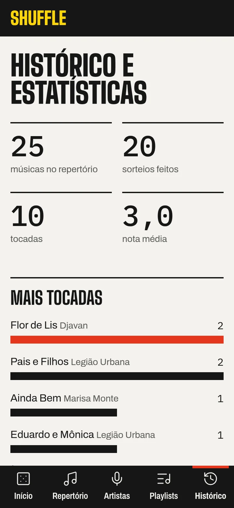
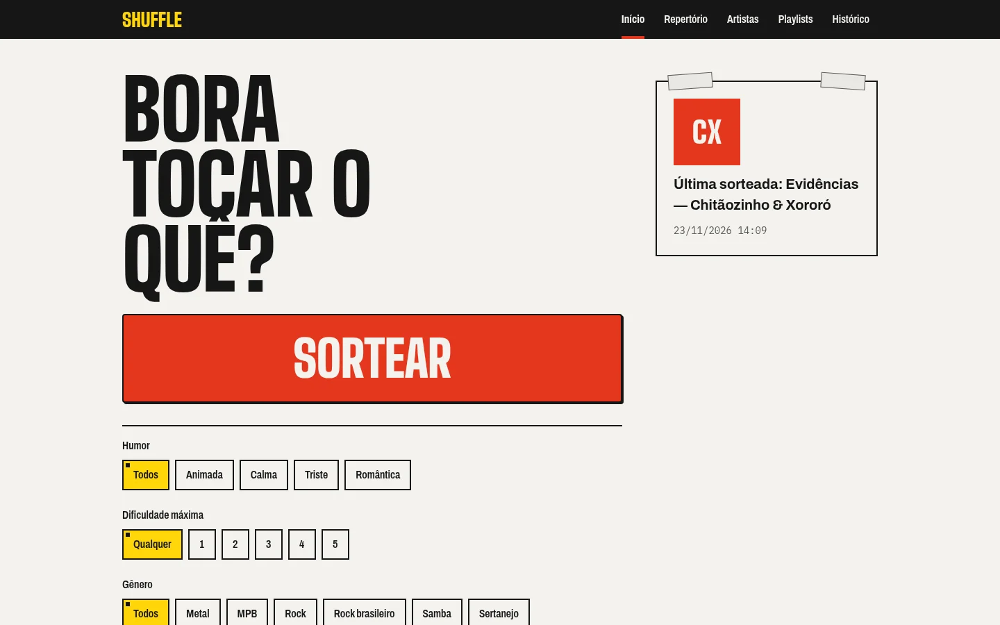
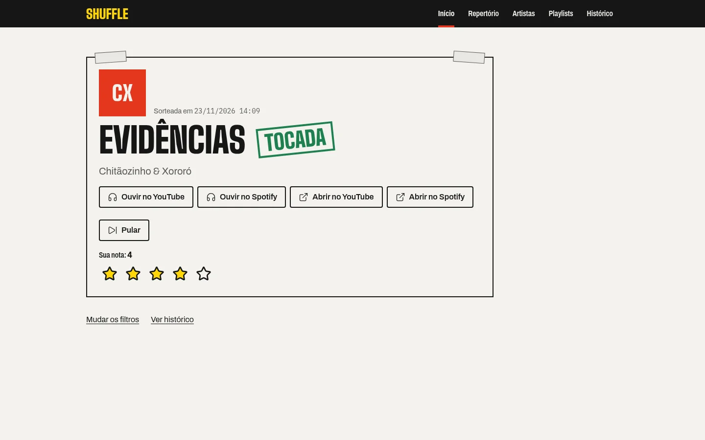

# Shuffle

Cadastre as músicas que você já sabe tocar e deixe o Shuffle sortear qual vai ser a próxima.

Trabalho de G2 da disciplina de Engenharia de Software, desenvolvido com **OpenSpec** (especificar antes de programar).

## Equipe

- Kadu Brum Gavião
- Miguel Mombach Foza
- Josiel Paz

## Requisitos

- Python 3 e git: testado com Python 3.12.3 e git 2.43.0.
- Google Chrome (ou Chromium): só para a ferramenta `tools/verificar_links.py`.
- Node.js 20+ e a CLI do OpenSpec: só para o `openspec validate`.

O app usa só o Flask 3.1.3 (instalado no passo 4) e o SQLite que já vem com o Python. Não precisa de internet para rodar: fontes e ícones são servidos pelo próprio sistema.

## Como rodar

1. Clonar o repositório:

```bash
git clone https://github.com/kadugaviao/shuffle.git
```

2. Entrar na pasta:

```bash
cd shuffle
```

3. Criar e ativar o ambiente virtual (Linux e macOS):

```bash
python3 -m venv .venv
source .venv/bin/activate
```

No Windows (PowerShell):

```powershell
py -m venv .venv
.venv\Scripts\activate
```

4. Instalar as dependências:

```bash
pip install -r requirements.txt
```

5. Carregar os dados de exemplo (opcional):

```bash
python seed.py
```

6. Rodar:

```bash
flask --app shuffle_meu run
```

7. Abrir no navegador: http://127.0.0.1:5000

## Comandos úteis

Rodar os testes:

```bash
python -m unittest
```

Recriar o banco do zero com os dados de exemplo (pare o servidor antes):

```bash
rm -f instance/shuffle.db
python seed.py
```

O banco fica em `instance/shuffle.db` e é criado sozinho na primeira execução. O seed cria 18 artistas, 20 músicas e as playlists "Roda de violão" e "Churrasco":
- **Músicas:** rock, rock brasileiro, metal, samba, sertanejo e MPB, com os 4 humores, dificuldades de 1 a 5, 5 favoritas e 1 inativa.
- **Links:** todas as músicas têm faixa do Spotify, e 4 têm vídeo do YouTube que toca no player embutido ("Tempo Perdido", "Sonífera Ilha", "Trem das Onze" e "Evidências"). Os links foram conferidos no navegador e estão em [`docs/links-verificados.md`](docs/links-verificados.md).
- **Rodar de novo:** o seed pode rodar mais de uma vez. Ele não duplica nada nem sobrescreve o que você editou, mas recria os itens do seed que você excluiu.

Validar as specs (precisa de Node.js 20+; instale a CLI uma vez):

```bash
npm install -g @fission-ai/openspec
openspec validate --all --strict
```

Conferir se um link do YouTube ou do Spotify toca no player embutido (precisa de internet e do Google Chrome ou Chromium; não faz parte dos testes):

```bash
python tools/verificar_links.py "https://youtu.be/jNQXAC9IVRw"
```

Para cada link, a ferramenta abre o player como o app abre. Ela mostra `OK` ou `FALHA` com o texto que aparece no player (título e canal ou artista), para você conferir se é a música certa. Para vários links, use `--arquivo links.txt`, com um link por linha.

## Problemas comuns

| Erro | Comando |
|---|---|
| `ModuleNotFoundError: No module named 'flask'` | Ative o ambiente virtual e instale as dependências: `source .venv/bin/activate` e depois `pip install -r requirements.txt` |
| `Error: Could not locate a Flask application` | Rode da pasta do projeto, com o `--app`: `cd shuffle` e depois `flask --app shuffle_meu run` |
| Porta 5000 ocupada (`Address already in use`; no macOS, o AirPlay usa a 5000) | Use outra porta e abra http://127.0.0.1:5001: `flask --app shuffle_meu run --port 5001` |
| YouTube "This video is unavailable" no player | O dono do vídeo bloqueou a incorporação. Confira com `python tools/verificar_links.py "<link>"`. Se der `FALHA`, use "Abrir no YouTube" ou edite a música com outro vídeo. |

## OpenSpec

Cada mudança passa por quatro passos:
1. **explore:** conversar sobre a ideia e os riscos, sem escrever nada.
2. **propose:** escrever `proposal.md`, deltas das specs, `design.md` e `tasks.md`, e commitá-los **antes** do código.
3. **apply e archive:** implementar as tarefas uma a uma; ao terminar, arquivar a mudança e incorporar as deltas às specs.

Onde ficam:
- **Specs atuais**, com os requisitos, as regras RN01 a RN08 e os cenários: [`openspec/specs/`](openspec/specs/)
  - `artistas`, `musicas`, `playlists`, `sorteio`, `historico`, `estatisticas` e `interface`.
- **Mudanças arquivadas:** [`openspec/changes/archive/`](openspec/changes/archive/)
  - `add-mvp`: banco, CRUD, sorteio e histórico;
  - `add-estatisticas-e-visual`: estatísticas e atalhos;
  - `refaz-identidade-visual`: nome "Shuffle" e design system "Lambe-lambe";
  - `add-player-embutido`: player do YouTube e do Spotify no resultado;
  - `add-links-por-servico`: um campo de link por serviço e o seed com links verificados.
- **Mudança em andamento:** `openspec/changes/revisao-final/`, a revisão antes da apresentação. O relatório está em [`docs/revisao-final.md`](docs/revisao-final.md).
- **Plano do projeto:** [`docs/plan.md`](docs/plan.md).

Comandos usados no Claude Code: `/openspec-explore`, `/openspec-propose <nome>`, `/openspec-apply-change <nome>` e `/openspec-archive-change <nome>`.

## Stack e pastas

| Camada | Tecnologia |
|---|---|
| Back-end | Python 3 + Flask 3.1.3 |
| Banco | SQLite, pelo módulo `sqlite3` da biblioteca padrão (sem ORM), 5 tabelas |
| Front-end | Templates Jinja, HTML, CSS e JavaScript puros (sem framework nem bundler) |
| Testes | `unittest` da biblioteca padrão |
| Especificação | OpenSpec |

```
shuffle/
├── shuffle_meu/          o app Flask
│   ├── __init__.py       create_app(): configuração, banco e blueprints
│   ├── schema.sql        as 5 tabelas e as regras de negócio no banco
│   ├── db.py             conexão SQLite
│   ├── artistas.py       CRUD de artistas
│   ├── musicas.py        CRUD de músicas e validações
│   ├── playlists.py      playlists e suas músicas
│   ├── sorteio.py        algoritmo do sorteio e tela de resultado
│   ├── links.py          validação dos links e montagem do player
│   ├── historico.py      Toquei, notas e tela de histórico
│   ├── estatisticas.py   consultas das estatísticas
│   ├── templates/        telas (Jinja)
│   └── static/           CSS do design system, JS e fontes
├── tests/                testes automáticos
├── tools/                verificar_links.py
├── seed.py               dados de exemplo
├── docs/                 plano, links verificados, revisão final e screenshots
└── openspec/             specs e mudanças (ativas e arquivadas)
```

## Telas e limitações conhecidas

No celular (390 px):

| Início | Resultado do sorteio | Histórico e estatísticas |
|---|---|---|
|  |  |  |

No desktop (1440 px):

| Início | Resultado do sorteio |
|---|---|
|  |  |

Limitações conhecidas:
- **Uso local:** o app foi feito para uma pessoa no próprio computador e não tem login nem proteção CSRF. A `SECRET_KEY` cai em `"dev"` se a variável de ambiente não existir. Antes de publicar na internet, é preciso acrescentar essas proteções e definir `SECRET_KEY`.
- **Anti-repetição:** vale para o histórico inteiro, independentemente dos filtros do sorteio.
- **Player embutido:**
  - Carrega só depois do clique e precisa de internet nesse momento; a tela de resultado abre sem internet.
  - Vários vídeos oficiais bloqueiam a incorporação.
  - O Spotify toca só uma prévia de 30 s para quem não está logado no navegador.
  - Nesses casos, use "Abrir no YouTube" ou "Abrir no Spotify". Confira os links com `python tools/verificar_links.py` antes de apresentar.
- **Trabalho futuro:**
  - tocar arquivo de áudio local;
  - gravar a própria versão pelo microfone;
  - players de SoundCloud e Deezer;
  - proteção CSRF;
  - modos "Esquecidas", setlist e festa;
  - exportação CSV.

## Créditos

- Fontes [Big Shoulders Display](https://github.com/xotypeco/big_shoulders), [Archivo](https://github.com/Omnibus-Type/Archivo) e [IBM Plex Mono](https://github.com/IBM/plex), sob a SIL Open Font License 1.1, distribuídas pelos pacotes do [Fontsource](https://fontsource.org) (licenças em `shuffle_meu/static/fonts/`).
- Ícones do [Lucide](https://lucide.dev), licença ISC.
