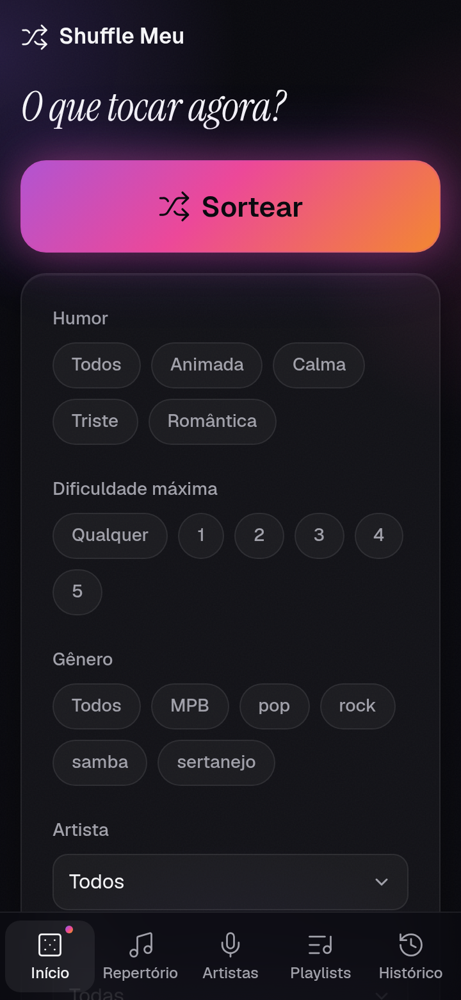
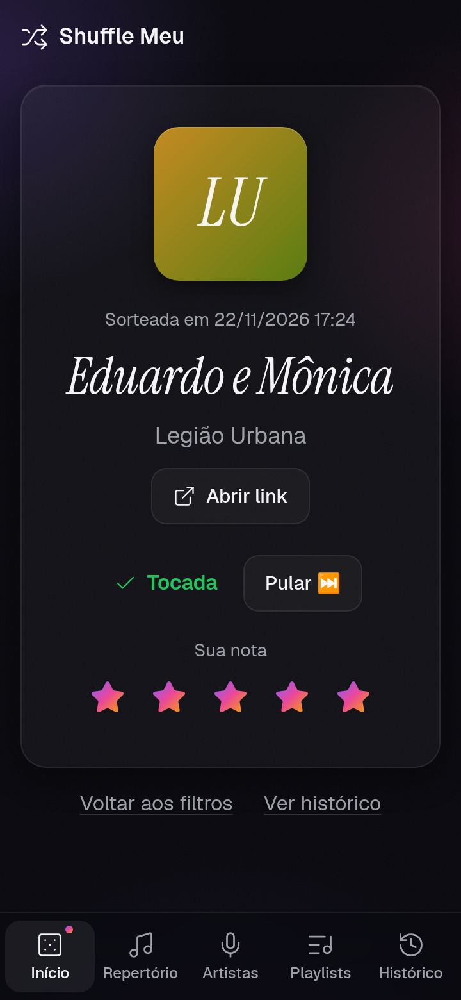
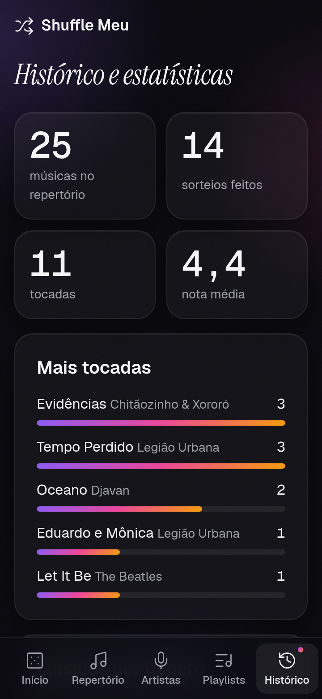

# Shuffle Meu 🎵

Sistema web para cadastrar as músicas que você **já conhece** e **sortear qual tocar** a seguir. O sorteio só usa músicas ativas, aceita filtros (gênero, humor, dificuldade máxima, artista, playlist), evita repetir as últimas N sorteadas e dá o dobro de chance às favoritas. A tela de histórico mostra as estatísticas: músicas mais tocadas, nunca sorteadas, média de notas e músicas por gênero.

A interface segue o design system "Midnight Stage" (tema escuro, cartões de vidro, um único gradiente de destaque), funciona no celular a partir de 360 px, respeita a preferência de movimento reduzido e não depende de internet: fontes e ícones são servidos pelo próprio sistema.

Trabalho de G2 da disciplina de Engenharia de Software, desenvolvido com **OpenSpec** (especificar antes de programar).

## Telas

| Início | Resultado do sorteio | Histórico e estatísticas |
|---|---|---|
|  |  |  |

Mais capturas, no celular e no desktop, em [`docs/screenshots/`](docs/screenshots/).

## Integrantes

- Kadu Brum Gavião
- Miguel Mombach Foza
- Josiel Paz

## Pré-requisitos

- Python 3 (testado com 3.12)

## Instalação

```bash
python -m venv .venv
source .venv/bin/activate        # Windows: .venv\Scripts\activate
pip install -r requirements.txt
```

## Carga inicial (opcional)

```bash
python seed.py
```

Cria dados de exemplo para a demonstração: 8 artistas, 25 músicas (rock, MPB, samba, sertanejo e pop; os 4 humores; dificuldades de 1 a 5; 6 favoritas e 1 inativa) e as playlists "Roda de violão" e "Churrasco".

- Pode ser rodado mais de uma vez: não duplica nada e não sobrescreve o que você editou.
- Itens do seed que você excluiu **voltam a ser criados** se rodar de novo.

## Execução

```bash
flask --app shuffle_meu run
```

Abra http://127.0.0.1:5000. O banco SQLite é criado sozinho em `instance/shuffle.db` na primeira execução.

## Testes

```bash
python -m unittest
```

## Zerar o banco

Pare o servidor e apague o arquivo `instance/shuffle.db`. Ele é recriado vazio na próxima execução; rode `python seed.py` se quiser os dados de exemplo de novo. O mesmo vale se o `schema.sql` mudar: não há migrações.

## Estrutura

```
shuffle_meu/
  __init__.py      create_app(): configuração, banco e blueprints
  db.py            conexão SQLite (foreign_keys ligado)
  schema.sql       as 5 tabelas e as regras de negócio no banco
  artistas.py      CRUD de artistas
  musicas.py       CRUD de músicas e validações
  playlists.py     playlists e suas músicas
  sorteio.py       algoritmo do sorteio e tela de resultado
  historico.py     Toquei / Avaliar e tela de histórico
  estatisticas.py  consultas das estatísticas
  templates/       telas (Jinja)
  static/          CSS (design system), JS e fontes (static/fonts)
tests/             testes (unittest)
seed.py            carga inicial
openspec/          especificação (specs, proposta, design e tarefas)
```

## Especificação (OpenSpec)

Os requisitos, as regras de negócio RN01 a RN08 e os cenários de cada funcionalidade estão em [`openspec/specs/`](openspec/specs/). A mudança que implementou o MVP está arquivada em [`openspec/changes/archive/2026-11-22-add-mvp/`](openspec/changes/archive/2026-11-22-add-mvp/).

```bash
openspec validate --specs --strict
```

## Limitações conhecidas

- Feito para uso local por uma pessoa: não há login nem proteção CSRF. Não publique o servidor na internet sem adicionar isso e definir a variável de ambiente `SECRET_KEY`.
- A anti-repetição vale para o histórico inteiro, independentemente dos filtros usados no sorteio.
- Modo "Esquecidas", setlist, modo festa, CSV, desafio e player embutido ficaram para trabalhos futuros (ver o `proposal.md` das mudanças em `openspec/changes/`).

## Créditos

- Fontes [Geist e Geist Mono](https://github.com/vercel/geist-font) e [Instrument Serif](https://github.com/Instrument/instrument-serif), sob a SIL Open Font License 1.1, distribuídas pelos pacotes do [Fontsource](https://fontsource.org) (licenças em `shuffle_meu/static/fonts/`).
- Ícones do [Lucide](https://lucide.dev), licença ISC.
